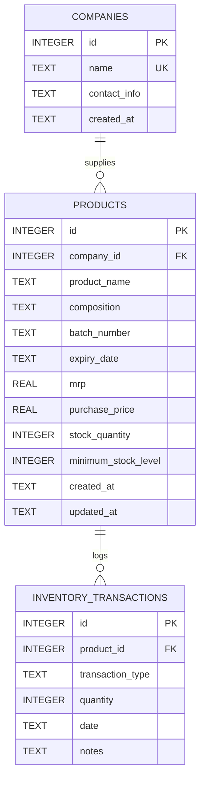
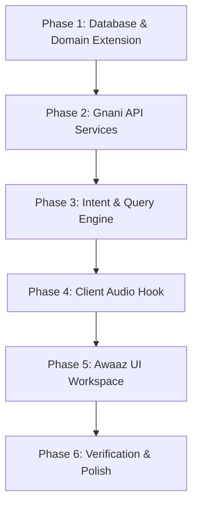

# Awaaz Project Discovery, Architecture & Frontend Assessment Report

**Project:** Awaaz — Voice-First Business Operations Assistant  
**Challenge:** The Great Indian AI Internship Challenge (Gnani AI)  
**Workspace Root:** `c:\Users\Vaibhav Verma\Documents\VV-Plak\Gnani`  
**Application Root:** `c:\Users\Vaibhav Verma\Documents\VV-Plak\Gnani\Med-Inventory`  
**Documentation Directory:** `c:\Users\Vaibhav Verma\Documents\VV-Plak\Gnani\docs`  
**Date:** October 19, 2026  
**Status:** Complete Discovery & Planning Deliverable  

---

## 1. Executive Summary

This report establishes the architectural baseline, technical capabilities, and implementation roadmap for **Awaaz**, a voice-first business operations assistant built for the Great Indian AI Internship Challenge by Gnani AI.

### Core Discoveries
1. **Existing Foundation (MediDist)**: The repository contains a functional medical inventory application featuring a React Native (Expo SDK 54) frontend, an Express 4.21.2 backend, and an embedded SQLite database using `better-sqlite3` v12.5.0 with WAL journaling.
2. **Current Strengths**: The backend already possesses robust CRUD routes for companies and products, real-time inventory tracking, low-stock threshold queries, expiry monitoring, financial aggregation summaries, and a Groq-powered PDF/Excel catalogue extraction pipeline.
3. **Critical Feature Gaps**:
   - **Voice & Speech**: There is currently **zero voice or audio infrastructure** in the codebase. Neither microphone capture, speech-to-text (STT), nor text-to-speech (TTS) audio playback exists in the application code. While Gnani Prisma (STT) and Gnani Timbre (TTS) have been verified independently by the developer, their integration into this project is completely pending.
   - **Customer & Balance Domain**: The database contains only `companies`, `products`, and `inventory_transactions`. There is **no `customers` table**, no balance tracking, and no payment-reminder drafting capability.
   - **Natural Language Grounding**: No intent parser or database query grounding pipeline is currently implemented.
4. **Workspace Organization**: The workspace has been cleanly partitioned into `Med-Inventory/` (application source code) and `docs/` (audits, specifications, planning deliverables). Redundant nested wrappers have been eliminated, and database files remain 100% intact.
5. **Architectural Recommendation**: The report evaluates **Option A** (repairing and extending Expo Web) versus **Option B** (building a separate React + Vite frontend). Based on code reuse, browser MediaRecorder compatibility, and solo-developer velocity, an evidence-based recommendation is presented in [Section 10](#10-existing-frontend-versus-separate-vite-frontend-comparison).

---

## 2. Verified Workspace and Repository Structure

The Gnani project directory is organized into two primary root domains:

```
c:\Users\Vaibhav Verma\Documents\VV-Plak\Gnani\
│
├── Med-Inventory/                        [APPLICATION ROOT]
│   ├── .expo/                            (Expo cache and local configuration)
│   ├── .gitignore                        (Version control exclusions including SQLite WAL/SHM)
│   ├── .replit                           (Replit Cloud Run deployment workflow)
│   ├── MedStock_ARCHAEOLOGY.md           (Historical project analysis)
│   ├── Project_Arch_Prompt.txt           (Original scaffold prompt)
│   ├── app.json                          (Expo application manifest)
│   ├── assets/                           (Static icon and splash image assets)
│   ├── attached_assets/                  (Reference assets and generated images)
│   ├── babel.config.js                   (Babel preset configuration for React Native/Expo)
│   ├── client/                           (React Native / Expo frontend source)
│   │   ├── App.tsx                       (Frontend entry point with providers and font loaders)
│   │   ├── components/                   (21 modular UI components)
│   │   ├── constants/                    (Theme, typography, spacing tokens)
│   │   ├── hooks/                        (Theme, screen options, color scheme hooks)
│   │   ├── index.js                      (Entry point for Expo registerRootComponent)
│   │   ├── lib/                          (TanStack Query client and API request helper)
│   │   ├── navigation/                   (Stack and bottom-tab navigators)
│   │   └── screens/                      (9 application screens)
│   ├── data/                             [PERSISTED DATABASE]
│   │   ├── inventory.db                  (SQLite database: 4,096 bytes)
│   │   ├── inventory.db-shm              (SQLite shared memory index: 32,768 bytes)
│   │   └── inventory.db-wal              (SQLite write-ahead log: 189,552 bytes)
│   ├── design_guidelines.md              (MediDist visual and interaction guidelines)
│   ├── eslint.config.js                  (ESLint 9 flat configuration)
│   ├── node_modules/                     (Installed third-party packages)
│   ├── package-lock.json                 (Deterministic dependency lockfile)
│   ├── package.json                      (Project dependencies and scripts)
│   ├── replit.md                         (Replit environment instructions)
│   ├── scripts/
│   │   └── build.js                      (Static Expo Go deployment bundling script)
│   ├── server/                           (Express + TypeScript backend source)
│   │   ├── db.ts                         (SQLite connection, WAL pragma, schema setup)
│   │   ├── groq-client.ts                (Groq Llama-3.3-70b catalogue extraction client)
│   │   ├── index.ts                      (Express server, CORS, proxy, error handler)
│   │   ├── routes.ts                     (API endpoints for products, companies, reports)
│   │   ├── templates/
│   │   │   └── landing-page.html         (Replit web preview template)
│   │   └── upload-routes.ts              (Multer upload, PDF/Excel text extraction)
│   ├── server_dist/                      (Compiled production backend bundle)
│   ├── shared/                           (Shared TypeScript definitions: types.ts)
│   ├── tsconfig.json                     (TypeScript configuration with path aliases)
│   └── uploads/                          (Temporary upload folder with .gitkeep)
│
└── docs/                                 [DOCUMENTATION REPOSITORY]
    ├── AWAAZ_CODEBASE_AUDIT.md           (Initial comprehensive codebase audit)
    ├── AWAAZ_CLEANUP_REPORT.md           (Baseline stabilization and cleanup report)
    ├── AWAAZ_DIRECTORY_ORGANIZATION_REPORT.md (Directory organization and move verification)
    ├── AWAAZ_PROJECT_DISCOVERY_REPORT.md (This discovery deliverable)
    ├── AwaazPRD.md                       (Product Requirements Document for Awaaz MVP)
    ├── Awaaz_DirectoryDetails            (Task requirements and phase instructions)
    └── context/                          (Gnani AI challenge reference materials)
        ├── Challenge-Summary-and-Plan.md
        ├── about_gnani.md
        ├── api docs gnani.md
        ├── gnani_ai_internship_challenge.md
        └── gnani_artha_overview.md
```

---

## 3. Exact Commands to Run and Access the Frontend and Backend

### Platform Execution Realities: Windows PowerShell vs. POSIX Bash

> [!IMPORTANT]
> The scripts inside `Med-Inventory/package.json` contain POSIX-specific syntax:
> - `"server:dev": "NODE_ENV=development tsx server/index.ts"`
> - `"all:dev": "npm run expo:dev & npm run server:dev"`
>
> On Windows PowerShell, prepending `NODE_ENV=development` directly causes a syntax error because PowerShell expects `$env:NODE_ENV="development"`. Similarly, PowerShell treats `&` as the call operator rather than a background job operator. The verified Windows-compatible commands are detailed below.

### 1. Standalone Backend Server

| Setting | Value |
| :--- | :--- |
| **Working Directory** | `c:\Users\Vaibhav Verma\Documents\VV-Plak\Gnani\Med-Inventory` |
| **Windows PowerShell Command** | `npx tsx server/index.ts` *(or `$env:PORT="5000"; npx tsx server/index.ts`)* |
| **POSIX / Bash Command** | `npm run server:dev` |
| **Terminal Requirement** | Dedicated Terminal 1 |
| **Listening Port** | Port `5000` (default) or value of `$env:PORT` |
| **Browser URL to Test** | `http://localhost:5000/api/dashboard/stats` |
| **Verification Evidence** | Verified on port 5098 during testing; responded with 200 OK and valid JSON in 7ms |
| **Safe Stop Method** | Press `Ctrl+C` in the terminal |

### 2. Standalone Frontend (Metro Bundler)

| Setting | Value |
| :--- | :--- |
| **Working Directory** | `c:\Users\Vaibhav Verma\Documents\VV-Plak\Gnani\Med-Inventory` |
| **Windows PowerShell Command** | `npx expo start --localhost` |
| **POSIX / Bash Command** | `npm run expo:dev` |
| **Terminal Requirement** | Dedicated Terminal 2 |
| **Listening Port** | Port `8081` (Metro bundler) |
| **Target Platforms** | **Web Browser:** Press `w` in terminal or navigate to `http://localhost:8081`<br>**Mobile (Expo Go):** Scan terminal QR code on iOS/Android device on same Wi-Fi<br>**Mobile Emulator:** Press `a` (Android) or `i` (iOS simulator) |
| **Safe Stop Method** | Press `Ctrl+C` in the terminal |

### 3. How Frontend Connects to Backend

1. **API Client Resolution**:
   In `client/lib/query-client.ts`, `getApiUrl(path?: string)` reads `process.env.EXPO_PUBLIC_DOMAIN`. If unset, it defaults to `"localhost:5000"`, automatically prefixing `http://` for local requests.
2. **Reverse Proxying via Express**:
   In `server/index.ts`, Express configures `http-proxy-middleware`. Any incoming request to `http://localhost:5000` that does not begin with `/api` or `/upload` is dynamically proxied to Metro on `http://localhost:8081`. Thus, navigating to `http://localhost:5000/web` proxies directly to the Metro web bundle.

### 4. Build and Code Quality Commands

All commands run from `c:\Users\Vaibhav Verma\Documents\VV-Plak\Gnani\Med-Inventory`:

```powershell
# 1. Typecheck entire codebase (frontend + backend + shared)
npx tsc --noEmit
# Expected output: Exits code 0 with 0 errors

# 2. Check code formatting across all files
npm run check:format
# Expected output: "All matched files use Prettier code style!"

# 3. Format code with Prettier
npm run format

# 4. Run ESLint static analysis
npx eslint client server shared
# Expected output: 0 errors (13 non-blocking warnings)

# 5. Build production backend bundle
npm run server:build
# Expected output: Bundles into server_dist/index.js via esbuild (~18ms)

# 6. Run production backend
node server_dist/index.js
```

---

## 4. Frontend Architecture and Screen Inventory

### Architecture Overview
- **Framework**: React Native with Expo SDK 54, running React 19.1.0 and `react-native-web` ~0.21.0.
- **Root Entry**: `client/index.js` invokes `registerRootComponent(App)`. `client/App.tsx` configures `ErrorBoundary`, `QueryClientProvider`, `SafeAreaProvider`, `GestureHandlerRootView`, `KeyboardProvider`, and loads the Feather icon font.
- **Navigation Stack**: Managed via `@react-navigation/native` v7:
  - `RootStackNavigator`: Holds `MainTabNavigator` (`client/navigation/MainTabNavigator.tsx`).
  - `MainTabNavigator`: Bottom tab bar with 4 tabs:
    1. **DashboardTab**: Wrapped in `DashboardStackNavigator`
    2. **ProductsTab**: Wrapped in `ProductsStackNavigator`
    3. **CompaniesTab**: Wrapped in `CompaniesStackNavigator`
    4. **ReportsTab**: Wrapped in `ReportsStackNavigator`

### Screen Inventory

| Screen Name | File Path | Purpose & Functionality | API Calls Made |
| :--- | :--- | :--- | :--- |
| **Dashboard** | `client/screens/DashboardScreen.tsx` | Displays high-level KPIs (Total Products, Total Companies, Low Stock Count, Expiring Soon), quick action navigation buttons, and low-stock alert previews. | `GET /api/dashboard/stats`<br>`GET /api/products/low-stock` |
| **LowStock** | `client/screens/LowStockScreen.tsx` | Dedicated view listing all items where `stock_quantity <= minimum_stock_level`. Offers quick stock increment actions via modal. | `GET /api/products/low-stock`<br>`PATCH /api/products/:id/stock` |
| **Products** | `client/screens/ProductsScreen.tsx` | Full inventory directory with instant search (name, composition, batch), company dropdown filter, stock level badges, and stock adjustment modal. | `GET /api/products`<br>`GET /api/companies`<br>`PATCH /api/products/:id/stock` |
| **AddProduct** | `client/screens/AddProductScreen.tsx` | Form to create a product (name, company selector, composition, batch, future expiry date, MRP, purchase price, opening stock, min level). | `GET /api/companies`<br>`POST /api/products` |
| **EditProduct** | `client/screens/EditProductScreen.tsx` | Form to update product metadata, pricing, batch, and stock levels. | `GET /api/products/:id`<br>`GET /api/companies`<br>`PUT /api/products/:id` |
| **ImportCatalogue** | `client/screens/ImportCatalogueScreen.tsx` | Document upload workflow. Accepts PDF, Excel, CSV files, sends to backend Groq AI extractor, renders extracted products in review table, and imports to company. | `POST /api/upload/extract`<br>`POST /api/upload/import`<br>`GET /api/companies` |
| **Companies** | `client/screens/CompaniesScreen.tsx` | Directory of pharmaceutical distributors/suppliers with search and delete confirmation modal. | `GET /api/companies`<br>`DELETE /api/companies/:id` |
| **AddCompany** | `client/screens/AddCompanyScreen.tsx` | Form to add distributor/company (name, contact info). | `POST /api/companies` |
| **Reports** | `client/screens/ReportsScreen.tsx` | Business intelligence dashboard: Inventory valuation (stock count, invested capital, retail potential), company distribution, and transaction audit log. | `GET /api/reports/summary` |

### Reusable UI Components (`client/components/`)
The application possesses 21 modular components following consistent styling conventions:
- **Layout & Structure**: `Card.tsx`, `Spacer.tsx`, `ThemedView.tsx`, `HeaderTitle.tsx`
- **Data Presentation**: `StatCard.tsx`, `ProductListItem.tsx`, `CompanyListItem.tsx`, `ThemedText.tsx`
- **Inputs & Forms**: `FormInput.tsx`, `FormSelect.tsx`, `FormDatePicker.tsx`, `SearchBar.tsx`, `FilterSelect.tsx`
- **Actions & Feedback**: `Button.tsx`, `PrimaryButton.tsx`, `ConfirmModal.tsx`, `StockUpdateModal.tsx`
- **State Management**: `EmptyState.tsx`, `ErrorBoundary.tsx`, `ErrorFallback.tsx`, `KeyboardAwareScrollViewCompat.tsx`

### Current Audio/Voice Support
**Status: None (0%).**
There are no audio recording components, no playback audio controls, no permissions handlers for microphone input, and no audio libraries (`expo-av`, `react-native-audio`, etc.) installed.

---

## 5. Backend Architecture and API Route Inventory

### Architecture Overview
- **Runtime**: Express 4.21.2 on Node.js with TypeScript execution via `tsx` (development) and `esbuild` (production bundling).
- **CORS Handling**: `setupCors()` explicitly allows origins matching Replit domain variables and local development origins (`localhost` and `127.0.0.1` on any port) with credentials enabled.
- **Database Layer**: Direct synchronous execution via `better-sqlite3`. WAL mode enables concurrent reads without database lock contention.
- **Upload Pipeline**: `multer` middleware with a 10MB limit and MIME-type validation for `.pdf`, `.xlsx`, `.xls`, and `.csv`.
- **Catalogue Extraction**: In `server/groq-client.ts`, text extracted via `pdf-parse` or `xlsx` is fed to Groq's `llama-3.3-70b-versatile` with low temperature (0.1) to extract structured medicine records.

### Complete API Route Inventory

```
Base URL: http://localhost:5000/api
```

| HTTP Method | Route Endpoint | Purpose & Business Logic | Parameters / Body | Response Schema |
| :--- | :--- | :--- | :--- | :--- |
| **GET** | `/api/dashboard/stats` | Computes dashboard KPIs. Counts products, companies, low-stock items (`stock <= min`), and expiring items (`expiry <= +3 months`). | None | `{ totalProducts: number, totalCompanies: number, lowStockCount: number, expiringCount: number }` |
| **GET** | `/api/companies` | Retrieves all companies ordered alphabetically. | None | `Company[]` |
| **GET** | `/api/companies/:id` | Retrieves single company by primary key. | `id` (path param) | `Company` (or 404) |
| **POST** | `/api/companies` | Validates name uniqueness and inserts company. | `{ name: string, contact_info?: string }` | `Company` (201 Created) |
| **PUT** | `/api/companies/:id` | Validates uniqueness and updates company name/contact. | `id` (path param), `{ name: string, contact_info?: string }` | `Company` |
| **DELETE** | `/api/companies/:id` | Deletes company; cascade deletes associated products and transactions. | `id` (path param) | `{ message: string }` |
| **GET** | `/api/products` | Lists products with company joins. Supports filtering by company and keyword search (product name, composition, batch). | Query: `company_id`, `search` | `ProductWithCompany[]` |
| **GET** | `/api/products/low-stock` | Returns items where `stock_quantity <= minimum_stock_level`, ordered by stock deficit ratio. | None | `ProductWithCompany[]` |
| **GET** | `/api/products/expiring` | Returns items expiring within 3 months, ordered by nearest expiry date. | None | `ProductWithCompany[]` |
| **GET** | `/api/products/:id` | Retrieves single product joined with company name. | `id` (path param) | `ProductWithCompany` (or 404) |
| **POST** | `/api/products` | Validates fields (future expiry, positive prices), inserts product, and records opening `'in'` transaction. | `CreateProductInput` | `ProductWithCompany` (201 Created) |
| **PUT** | `/api/products/:id` | Updates product fields. If stock quantity changes, automatically records an `'in'` or `'out'` stock adjustment transaction. | `id` (path param), `UpdateProductInput` | `ProductWithCompany` |
| **DELETE** | `/api/products/:id` | Deletes product transactions, then deletes the product. | `id` (path param) | `{ message: string }` |
| **PATCH** | `/api/products/:id/stock` | Increments or decrements stock quantity by `quantity` and logs `'in'`/`'out'` transaction. Stock quantity cannot drop below 0. | `id` (path param), `{ quantity: number, type: 'add' \| 'remove' }` | `ProductWithCompany` |
| **GET** | `/api/reports/summary` | Aggregates portfolio metrics: Total products, stock count, purchase valuation, retail value; stock by company; 10 recent transactions. | None | `{ inventory: InventoryStats, distribution: CompanyDist[], transactions: Transaction[] }` |
| **POST** | `/api/upload/extract` | Multer receives file, extracts text via `pdf-parse` or `xlsx`, passes to Groq Llama-3.3-70b to extract structured medicine records. | Multipart form: `file` | `{ success: true, extractedCount: number, medicines: ExtractedMedicine[] }` |
| **POST** | `/api/upload/import` | Batch inserts extracted medicines into `products` table under specified `companyId`. Logs opening transactions. | `{ medicines: ExtractedMedicine[], companyId: number }` | `{ success: true, importedCount: number, products: ProductWithCompany[] }` |

---

## 6. Database Schema and Business Logic

The database is powered by SQLite (`better-sqlite3`) located at `Med-Inventory/data/inventory.db`.



### Table Definitions and Constraints
1. **`companies`**:
   - `id`: Auto-incrementing primary key.
   - `name`: Unique constraint (`TEXT NOT NULL UNIQUE`). Case-sensitive unique index.
   - `contact_info`: Optional text field for phone/email.
2. **`products`**:
   - `id`: Auto-incrementing primary key.
   - `company_id`: Foreign key referencing `companies(id)` with `ON DELETE CASCADE`.
   - `product_name`, `batch_number`, `expiry_date`: Required string fields.
   - `mrp`, `purchase_price`: Real numbers representing financial amounts.
   - `stock_quantity`: Integer representing physical count (defaults to 0).
   - `minimum_stock_level`: Alert threshold integer (defaults to 10).
3. **`inventory_transactions`**:
   - `id`: Auto-incrementing primary key.
   - `product_id`: Foreign key referencing `products(id)` with `ON DELETE CASCADE`.
   - `transaction_type`: String representing direction (`'in'`, `'out'`, `'adjustment'`).
   - `quantity`: Number of units adjusted.
   - `date`: Timestamp defaults to `datetime('now')`.

### Calculations & Business Invariants
- **Stock Depletion & Low Stock**: Evaluated dynamically using `stock_quantity <= minimum_stock_level`. In `GET /api/products/low-stock`, results are sorted by deficit ratio `(stock_quantity * 1.0 / minimum_stock_level) ASC` so critically depleted products surface first.
- **Inventory Valuation**: Calculations are derived dynamically at query time in `GET /api/reports/summary`:
  - `total_investment = SUM(purchase_price * stock_quantity)`
  - `potential_revenue = SUM(mrp * stock_quantity)`
- **Transaction Consistency**: Whenever stock changes through `POST /api/products`, `PUT /api/products/:id`, or `PATCH /api/products/:id/stock`, an entry is immediately recorded in `inventory_transactions`.

---

## 7. External Services and Configuration Requirements

### Current Services Map

| Service | Integration Point | Required Configuration | Verified Status |
| :--- | :--- | :--- | :--- |
| **Groq API** | `server/groq-client.ts`<br>`server/upload-routes.ts` | `GROQ_API_KEY` | **Configured & Active**: Uses `llama-3.3-70b-versatile` to parse medicine catalogue text into structured JSON. |
| **Replit Deployment** | `server/index.ts`<br>`.replit`<br>`scripts/build.js` | `REPLIT_DEV_DOMAIN`<br>`EXPO_PUBLIC_DOMAIN`<br>`PORT` | **Configured**: Supports Replit Cloud Run container routing and Metro proxying. |
| **Gnani Prisma STT** | *Not yet integrated in codebase* | API key, token, endpoint | **Pending Integration**: Tested independently by developer; code client not yet authored. |
| **Gnani Timbre TTS** | *Not yet integrated in codebase* | API key, token, endpoint | **Pending Integration**: Tested independently by developer; code client not yet authored. |

---

## 8. Existing Functionality and Verification Evidence

| Capability | Verification Command / Code Path | Verification Evidence |
| :--- | :--- | :--- |
| **TypeScript Compilation** | `npx tsc --noEmit` | Exit code 0. Zero errors across all client, server, and shared files. |
| **Prettier Formatting** | `npm run check:format` | Exit code 0. "All matched files use Prettier code style!" |
| **ESLint Static Analysis** | `npx eslint client server shared` | Exit code 0. 0 errors (13 non-blocking warnings). |
| **Database Persistence** | `node -e "better-sqlite3 ..."` | `Companies: 1`, `Products: 1`, `Transactions: 1`. Existing seed record (*Dharishah Ayurveda* / *Deliv*) preserved. |
| **Dashboard Stats API** | `Invoke-RestMethod http://localhost:5098/api/dashboard/stats` | 200 OK: `{ totalProducts: 1, totalCompanies: 1, lowStockCount: 0, expiringCount: 0 }` |
| **Company Directory API** | `Invoke-RestMethod http://localhost:5098/api/companies` | 200 OK: Returns array containing `Dharishah Ayurveda` (id: 3). |
| **Backend Bundling** | `npm run server:build` | `server_dist/index.js` generated in 18ms via esbuild. |

---

## 9. Awaaz Feature Gap Matrix

This matrix evaluates the 7 required Awaaz PRD workflows against the current codebase:

| PRD Requirement | Status | Reusable Assets | Required Code Changes | Technical Risk | Recommended Implementation Approach |
| :--- | :--- | :--- | :--- | :--- | :--- |
| **1. Low-Stock Query**<br>Ask which products are low in stock; receive grounded answer. | **Partially Implemented** | `GET /api/products/low-stock`<br>`ProductListItem.tsx`<br>`StatCard.tsx` | Needs speech query intent parser to map voice request to `/api/products/low-stock` and format response string. | Low | Connect intent extraction to existing endpoint. Query returns products ordered by deficit ratio. |
| **2. Customer Balances**<br>Ask which customers have outstanding balances; receive verified answer. | **Missing** | `Card.tsx`<br>`ThemedText.tsx`<br>`StatCard.tsx` | **Database Schema:** No `customers` table exists. Must create table and seed customer balances. Must add `GET /api/customers/outstanding` backend route. | Medium | Add `customers` table to `server/db.ts` with `name`, `phone`, `outstanding_balance`, `due_date`. Add query route. |
| **3. Payment Reminder Draft**<br>Draft payment reminder using verified customer data; allow review & copy. | **Missing** | `Card.tsx`<br>`PrimaryButton.tsx`<br>`FormInput.tsx` | Must implement reminder template generator that injects verified customer name, amount, and due date. Must add clipboard copy action. | Low | Create client-side template formatter and "Copy to Clipboard" button (`expo-clipboard` or browser `navigator.clipboard`). |
| **4. Voice Input & Review**<br>Speak request, review transcription before query execution. | **Missing** | `SearchBar.tsx`<br>`FormInput.tsx`<br>`ConfirmModal.tsx` | **Audio Capture:** Needs browser `MediaRecorder` or Expo audio hook. Needs backend proxy route to Gnani Prisma STT API. | Medium | Add microphone recording button; stream/upload audio blob to backend `POST /api/voice/transcribe`; display editable transcript card. |
| **5. Audio TTS Playback**<br>Hear response through Timbre; readable text as fallback. | **Missing** | `ThemedText.tsx`<br>`Card.tsx` | Needs backend proxy route to Gnani Timbre TTS API. Needs client audio player (`HTMLAudioElement` on web or `expo-av` on native). | Medium | Backend calls Timbre TTS, returns audio stream/URL or base64. Client plays audio with play/pause button and renders text response card. |
| **6. Entity Clarification**<br>Clarify ambiguous product/customer names rather than guessing. | **Missing** | `FilterSelect.tsx`<br>`ConfirmModal.tsx` | Needs disambiguation logic when an intent returns multiple matching products or customers (e.g. fuzzy match score threshold). | Medium | Backend returns `status: "disambiguation_required"` with candidates list. UI renders selectable candidate chips. |
| **7. Processing & Error States**<br>Show clear recording, processing, confirmation, error states. | **Partially Implemented** | `EmptyState.tsx`<br>`ErrorBoundary.tsx`<br>`ErrorFallback.tsx` | Reusable feedback components exist, but voice-specific states (Recording, Transcribing, Querying, Synthesizing) must be wired into workspace UI. | Low | Build a cohesive voice workspace card displaying distinct status indicators for each state. |

---

## 10. Existing Frontend Versus Separate Vite Frontend Comparison

An objective comparison between **Option A (Repair & Extend Expo Frontend)** and **Option B (Separate React + Vite Frontend)**:

| Evaluation Criterion | Option A: Repair & Extend Expo Frontend | Option B: Build Separate React + Vite Web Frontend |
| :--- | :--- | :--- |
| **Time to Implement** | **Faster (1-2 days)**: Navigation, UI layout, themes, icons, and API client already exist. Only an `AwaazScreen.tsx` tab needs to be added. | **Moderate (2-3 days)**: Requires scaffolding a new Vite project, configuring Tailwind/CSS, rebuilding layout, navigation, and setting up TanStack Query from scratch. |
| **Amount of Code Reuse** | **Very High (~80%)**: Directly reuses `MainTabNavigator`, 21 UI components (`Card`, `ThemedText`, `Button`, `EmptyState`), color tokens, and existing inventory screens. | **Low to Moderate (~35%)**: Reuses backend routes, shared TypeScript types (`@shared/types`), and business logic, but all UI components must be recreated for DOM HTML. |
| **Browser Microphone / Audio** | **Feasible via Web Guards**: Browser `navigator.mediaDevices.getUserMedia`, `MediaRecorder`, and `new Audio()` work in React Native Web using `Platform.OS === 'web'`. | **Native & Seamless**: Standard HTML5 audio elements and Web Audio APIs work out of the box without React Native abstraction layers. |
| **Deployment Complexity** | **Moderate**: Requires running Metro bundler on port 8081 with Express reverse proxying on port 5000, or running static bundling via `scripts/build.js`. | **Simple**: Running `vite build` produces static HTML/JS files in `dist/`, which Express can serve natively with `express.static("dist")`. |
| **Risk of Breaking MediDist** | **Zero / Low**: Adding an Awaaz tab or workspace preserves all existing MediDist screens and routes without interference. | **Zero**: Existing MediDist app is untouched in its own directory. |
| **Maintainability After Challenge** | **Unified**: Maintains a single codebase capable of targeting both web and mobile platforms (iOS/Android via Expo Go). | **Fragmented**: Results in two disparate frontends (Expo for mobile, Vite for web) sharing one backend. |

### Architectural Recommendation

> [!TIP]
> **Recommended Approach: Option A (Extend Existing Expo Frontend with Web Audio Guards)**
> 
> **Rationale:**
> 1. **Immediate Velocity**: The existing Expo frontend has already been stabilized (0 TypeScript errors, clean Prettier formatting, 0 ESLint errors). Reusing the established design tokens (`Colors`, `Typography`), `Card`, `ThemedText`, `PrimaryButton`, and `EmptyState` allows immediate focus on the Gnani challenge core requirements: STT, TTS, intent parsing, and database grounding.
> 2. **Standard Web API Compatibility**: Since the challenge is evaluated in a web browser, standard browser APIs (`navigator.mediaDevices.getUserMedia`, `MediaRecorder`, `Audio`) execute without polyfills inside React Native Web when guarded with `Platform.OS === 'web'`.
> 3. **Single Cohesive Interface**: Rather than maintaining two frontends, adding an `Awaaz` tab to `MainTabNavigator` gives the evaluator a complete, polished product where voice operations immediately interact with live inventory and company data.

---

## 11. Recommended Awaaz Interface and Component Reuse Plan

For a solo developer with a strict challenge deadline, the primary Awaaz interface should be a **focused, single-workspace screen** (`AwaazScreen.tsx`) integrated directly into the bottom tab navigator.

### Workspace Visual Layout

```
+-------------------------------------------------------+
|  [Logo] Awaaz Business Assistant           (Online)   |
+-------------------------------------------------------+
|                                                       |
|  +-------------------------------------------------+  |
|  |                 VOICE CONTROL                   |  |
|  |                                                 |  |
|  |             (( [ Mic Icon Button ] ))           |  |
|  |                                                 |  |
|  |   Status: "Listening..." / "Processing..."       |  |
|  +-------------------------------------------------+  |
|                                                       |
|  +-------------------------------------------------+  |
|  |  TRANSCRIPT REVIEW                              |  |
|  |  "Which products are low in stock?"             |  |
|  |  [ Edit / Type Query Fallback ]   [ Submit ]    |  |
|  +-------------------------------------------------+  |
|                                                       |
|  +-------------------------------------------------+  |
|  |  GROUNDED RESULT CARD                           |  |
|  |                                                 |  |
|  |  Spoken Response: "You have 1 item low in stock"|  |
|  |  [ Play Audio (Timbre) ]  [ Pause ]             |  |
|  |                                                 |  |
|  |  Data Table / Entity Cards:                     |  |
|  |  - Deliv (Batch: DEL-001) | Stock: 4 / Min: 10  |  |
|  |                                                 |  |
|  |  -- PAYMENT REMINDER (When customer queried) -- |  |
|  |  "Dear Amit, this is a reminder regarding your  |  |
|  |   balance of Rs. 4,200 due on 2026-10-25."      |  |
|  |  [ Copy Reminder Text ]                         |  |
|  +-------------------------------------------------+  |
|                                                       |
+-------------------------------------------------------+
|  [ Dashboard ]  [ Products ]  [ Awaaz* ]  [ Reports ] |
+-------------------------------------------------------+
```

### Component Reuse Strategy

| Existing Component | Planned Usage in Awaaz Interface |
| :--- | :--- |
| `Card.tsx` | Container for Voice Control, Transcript Review, and Result Cards. |
| `ThemedText.tsx` | All typography, status labels, headers, and transcription readouts. |
| `PrimaryButton.tsx` / `Button.tsx` | "Start Recording", "Submit Query", "Play Spoken Response", "Copy Reminder". |
| `SearchBar.tsx` / `FormInput.tsx` | Text fallback input for users without microphone access or when editing transcriptions. |
| `StatCard.tsx` | Quick stat display for queried balances or low stock counts. |
| `ProductListItem.tsx` | Rendering grounded inventory items returned by voice queries. |
| `EmptyState.tsx` | Initial idle state ("Tap microphone to speak or type a request"). |
| `ConfirmModal.tsx` | Disambiguation modal when multiple products/customers match voice input. |

---

## 12. File-by-File Patchwork Plan (Ordered by Implementation Phase)



### Phase 1: Database & Domain Extension
1. **`server/db.ts`**:
   - Add `CREATE TABLE IF NOT EXISTS customers (...)` with fields: `id`, `name`, `phone`, `outstanding_balance`, `due_date`, `created_at`.
   - Insert representative mock customer records (e.g., 3-5 pharmacy clients with realistic Indian names and outstanding balances).
2. **`shared/types.ts`**:
   - Add `Customer`, `CreateCustomerInput`, and `AwaazQueryResult` TypeScript interfaces.
3. **`server/routes.ts`**:
   - Add `GET /api/customers` and `GET /api/customers/outstanding` endpoints.

### Phase 2: Gnani API Client Services
1. **`server/services/gnani-prisma.ts`** *(New)*:
   - Implement `transcribeAudio(audioBuffer: Buffer, mimeType: string): Promise<string>` using Gnani Prisma STT API credentials.
2. **`server/services/gnani-timbre.ts`** *(New)*:
   - Implement `synthesizeSpeech(text: string, lang?: string): Promise<Buffer>` using Gnani Timbre TTS API credentials.

### Phase 3: Awaaz Intent & Grounded Query Engine
1. **`server/services/awaaz-intent.ts`** *(New)*:
   - Structured intent classifier: classifies transcript into `LOW_STOCK_QUERY`, `CUSTOMER_BALANCE_QUERY`, `PAYMENT_REMINDER_DRAFT`, or `UNKNOWN`.
   - Executes database query against SQLite (`products` or `customers`).
   - Generates natural language answer grounded in database truth.
   - Generates payment reminder draft if customer query detected.
2. **`server/awaaz-routes.ts`** *(New)*:
   - `POST /api/awaaz/transcribe`: Accepts audio upload, calls Prisma, returns transcript.
   - `POST /api/awaaz/query`: Accepts text query, runs intent extractor, grounds in DB, calls Timbre for audio, returns composite result.

### Phase 4: Frontend Audio Capture Hook
1. **`client/hooks/useAudioRecorder.ts`** *(New)*:
   - Manages browser `MediaRecorder` lifecycle (`startRecording`, `stopRecording`).
   - Collects audio chunks into a `Blob`.
   - Exposes recording duration, status flags (`isRecording`, `isTranscribing`).

### Phase 5: Awaaz UI Workspace Screen
1. **`client/screens/AwaazScreen.tsx`** *(New)*:
   - Implements the primary workspace using existing components (`Card`, `PrimaryButton`, `ThemedText`, `EmptyState`).
   - Wires `useAudioRecorder`, editable transcript input, grounded result display, and audio playback.
   - Includes "Copy Reminder" clipboard button.
2. **`client/navigation/MainTabNavigator.tsx`**:
   - Register `AwaazTab` with mic icon (`Feather name="mic"`).

### Phase 6: Verification & Presentation
1. Run end-to-end tests across all 7 PRD workflows.
2. Verify TypeScript (`tsc --noEmit`), Prettier, and ESLint.

---

## 13. Risks, Assumptions, and Unresolved Questions

### Technical Risks
1. **Browser Audio Format Compatibility**:
   - *Risk*: `MediaRecorder` in Chrome/Firefox typically produces `audio/webm;codecs=opus`. Gnani Prisma STT may require 16kHz WAV or PCM audio.
   - *Mitigation*: Verify accepted MIME types in Prisma API documentation (`docs/context/api docs gnani.md`). If PCM/WAV is required, implement a lightweight client-side WAV encoder or backend `ffmpeg`/`fluent-ffmpeg` conversion.
2. **Browser Autoplay Restrictions**:
   - *Risk*: Modern browsers block programmatic audio playback without prior user interaction.
   - *Mitigation*: Ensure Timbre TTS playback is triggered via an explicit "Play Response" button or tied to the "Stop Recording" user gesture.
3. **API Latency**:
   - *Risk*: Chaining STT -> Intent Extraction -> DB Query -> TTS might take 3-5 seconds.
   - *Mitigation*: Provide clear intermediate progress indicators ("Transcribing speech...", "Querying inventory...", "Synthesizing voice...") so the user is never left with an unresponsive UI.

### Unresolved Questions
1. Does Gnani Prisma support streaming audio via WebSocket, or is REST multipart upload the preferred integration method?
2. What are the specific voice model IDs and language codes for Timbre (e.g., Indian English vs. Hindi)?
3. Will the challenge evaluation be conducted purely on desktop Chrome, or should mobile browser viewports be prioritized?

---

## 14. Validation Commands and Results

| Command | Working Directory | Result | Notes |
| :--- | :--- | :--- | :--- |
| `npx tsc --noEmit` | `Med-Inventory/` | **Pass (Code 0)** | 0 TypeScript errors. Path aliases `@/*` and `@shared/*` resolve cleanly. |
| `npm run check:format` | `Med-Inventory/` | **Pass (Code 0)** | 100% Prettier compliance across all files. |
| `npx eslint client server shared` | `Med-Inventory/` | **Pass (Code 0)** | 0 lint errors, 13 pre-existing non-blocking warnings. |
| `node -e "better-sqlite3 ..."` | `Med-Inventory/` | **Pass (Code 0)** | Database record counts: 1 company, 1 product, 1 transaction. Untouched. |
| `Invoke-RestMethod http://localhost:5098/api/dashboard/stats` | `Med-Inventory/` | **Pass (200 OK)** | Backend initializes in WAL mode and serves valid dashboard statistics. |
| `Invoke-RestMethod http://localhost:5098/api/companies` | `Med-Inventory/` | **Pass (200 OK)** | Database queries execute successfully against `data/inventory.db`. |

---

## 15. Suggested Next Steps

1. **Step 1: User Git Initialization**:
   - Initialize Git in `c:\Users\Vaibhav Verma\Documents\VV-Plak\Gnani` (or `Med-Inventory/` per user preference).
   - Create the initial baseline commit.
2. **Step 2: Database Extension**:
   - Execute Phase 1 of the Patchwork Plan: Define `customers` table in `server/db.ts` and add sample distributor customers.
3. **Step 3: Service Layer Implementation**:
   - Create `server/services/gnani-prisma.ts` and `server/services/gnani-timbre.ts` using the independently verified Prisma and Timbre integration logic.
4. **Step 4: Awaaz Workspace UI**:
   - Build `client/screens/AwaazScreen.tsx` and integrate it into `MainTabNavigator.tsx`.
