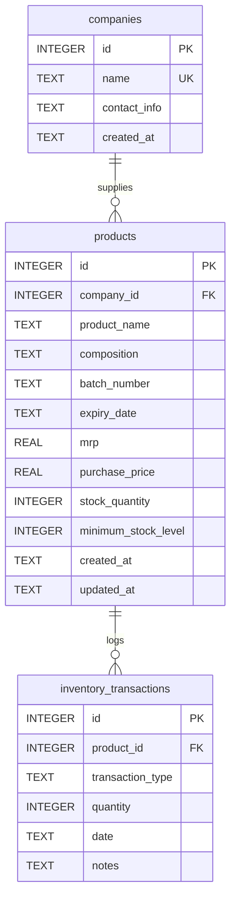
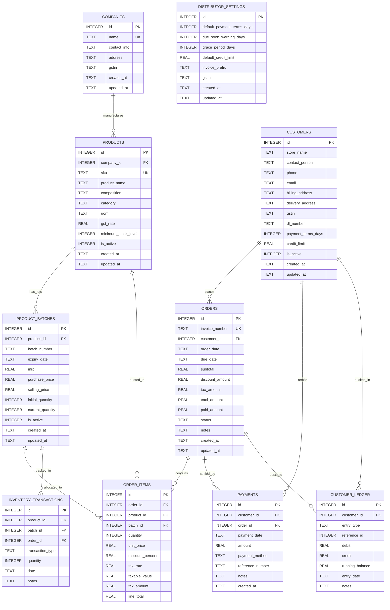
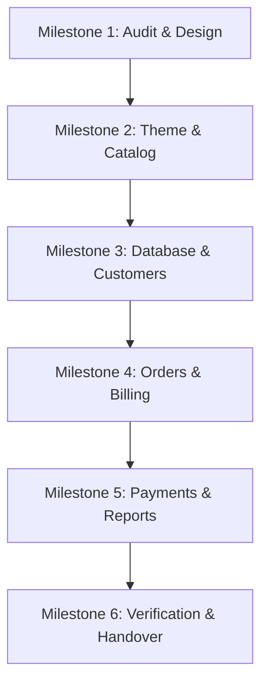

# MediDist Core Overhaul: Architecture Audit, Gap Analysis & Target Migration Plan

**Project:** MediDist Core Business Operations Overhaul  
**Target Audience:** Small and Medium-Sized Pharmaceutical Distributors (Pharmacies, Retailers, Wholesalers)  
**Workspace:** `c:\Users\Vaibhav Verma\Documents\VV-Plak\Gnani\Med-Inventory`  
**Documentation Path:** `c:\Users\Vaibhav Verma\Documents\VV-Plak\Gnani\docs\MEDIDIST_CORE_OVERHAUL_AUDIT_AND_MIGRATION_PLAN.md`  
**Date:** October 19, 2026  
**Status:** Phase 0 Complete — Audit & Migration Proposal Ready for Review  

---

## Executive Summary

This document presents the **Phase 0 Architecture Audit and Migration Plan** for upgrading MediDist from a single-batch inventory prototype into a production-grade, multi-manufacturer, batch-aware distribution management system with comprehensive customer credit, multi-company order billing, and receivables aging.

In strict compliance with the user directive, **no application code or database records have been modified in this phase**. This deliverable establishes the verified baseline of the existing codebase, provides an exhaustive gap analysis against the overhaul specifications, outlines a zero-data-loss SQLite schema migration, and details the file-by-file implementation sequence across Milestones 1 through 6.

---

## 1. Verified Architecture and Repository File Map

### 1.1 Technology Stack

| Layer | Component | Verified Version / Engine | Verification Method |
| :--- | :--- | :--- | :--- |
| **Frontend Framework** | React Native with Expo | Expo SDK `^54.0.23`, React `19.1.0` | `package.json` inspection |
| **Web Rendering** | React Native Web | `react-native-web` `~0.21.0` | `package.json` inspection |
| **State & Data Fetching**| TanStack Query | `@tanstack/react-query` `^5.90.7` | `client/lib/query-client.ts` |
| **Navigation** | React Navigation | `@react-navigation/native` `^7.1.8`, `@react-navigation/bottom-tabs` `^7.4.0` | `client/navigation/` |
| **Backend Framework** | Express | `express` `^4.21.2` with TypeScript (`tsx` dev, `esbuild` prod) | `server/index.ts` |
| **Persistence Engine** | SQLite 3 | `better-sqlite3` `^12.5.0` (WAL mode enabled) | `server/db.ts` |
| **Document AI Extractor**| Groq SDK | `groq-sdk` `^0.37.0` (`llama-3.3-70b-versatile`) | `server/groq-client.ts` |
| **Document Parsers** | PDF & Excel | `pdf-parse` `^2.4.5`, `xlsx` `^0.18.5`, `multer` `^2.0.2` | `server/upload-routes.ts` |

### 1.2 Repository File Map

```
c:\Users\Vaibhav Verma\Documents\VV-Plak\Gnani\Med-Inventory\
│
├── client/                                    [FRONTEND SOURCE]
│   ├── App.tsx                                (Root component: ErrorBoundary, QueryClient, Fonts)
│   ├── index.js                               (Expo entry point: registerRootComponent)
│   ├── constants/
│   │   └── theme.ts                           (Colors, Spacing, Typography, Shadows, BorderRadius)
│   ├── hooks/
│   │   ├── useTheme.ts                        (Returns active theme and isDark flag)
│   │   ├── useColorScheme.ts                  (Native color scheme hook)
│   │   ├── useColorScheme.web.ts              (Web color scheme listener: defaults to OS preference)
│   │   └── useScreenOptions.ts                (Header styling options for stack screens)
│   ├── lib/
│   │   └── query-client.ts                    (getApiUrl, apiRequest helper, TanStack queryClient)
│   ├── navigation/
│   │   ├── RootStackNavigator.tsx             (Hosts MainTabNavigator)
│   │   ├── MainTabNavigator.tsx               (Bottom tab navigator: 4 tabs)
│   │   ├── DashboardStackNavigator.tsx        (Dashboard, LowStock)
│   │   ├── ProductsStackNavigator.tsx         (Products, AddProduct, EditProduct, ImportCatalogue)
│   │   ├── CompaniesStackNavigator.tsx        (Companies, AddCompany)
│   │   └── ReportsStackNavigator.tsx          (Reports)
│   ├── screens/                               (9 existing screens)
│   │   ├── DashboardScreen.tsx                (KPI stats, quick actions, low stock alerts)
│   │   ├── LowStockScreen.tsx                 (Filtered low stock list with quick stock update)
│   │   ├── ProductsScreen.tsx                 (Catalogue list, search, company filter, stock modal)
│   │   ├── AddProductScreen.tsx               (Single product + batch creation form)
│   │   ├── EditProductScreen.tsx              (Product update form)
│   │   ├── ImportCatalogueScreen.tsx          (PDF/Excel upload, AI extraction, import table)
│   │   ├── CompaniesScreen.tsx                (Distributor company list, delete modal)
│   │   ├── AddCompanyScreen.tsx               (Distributor company creation form)
│   │   └── ReportsScreen.tsx                  (Valuation, company stock distribution, transactions)
│   └── components/                            (21 modular UI components)
│       ├── Button.tsx, PrimaryButton.tsx      (Action buttons with loading state)
│       ├── Card.tsx, StatCard.tsx             (Container cards and metric indicators)
│       ├── CompanyListItem.tsx                (Company card with contact info)
│       ├── ProductListItem.tsx                (Product item with stock badge & quick adjust)
│       ├── FormInput.tsx, FormSelect.tsx      (Standardized input and dropdown pickers)
│       ├── FormDatePicker.tsx                 (Date picker component)
│       ├── SearchBar.tsx, FilterSelect.tsx    (Catalogue search and filter pills)
│       ├── ConfirmModal.tsx                   (Destructive action confirmation dialog)
│       ├── StockUpdateModal.tsx               (Quick stock increment/decrement modal)
│       ├── EmptyState.tsx                     (Zero-state graphics and action callouts)
│       └── ErrorBoundary.tsx, ErrorFallback.tsx (React crash recovery)
│
├── server/                                    [BACKEND SOURCE]
│   ├── index.ts                               (Express setup, CORS, Metro proxy on 8081, port 5000)
│   ├── db.ts                                  (better-sqlite3 initialization, WAL mode, schema DDL)
│   ├── routes.ts                              (REST endpoints: Dashboard, Companies, Products, Reports)
│   ├── upload-routes.ts                       (Multer upload handling, PDF/Excel text extraction)
│   ├── groq-client.ts                         (Groq LLM extraction using llama-3.3-70b-versatile)
│   └── templates/
│       └── landing-page.html                  (Replit preview landing page)
│
├── shared/
│   └── types.ts                               (Company, Product, ProductWithCompany, Transaction, etc.)
│
├── data/                                      [PERSISTED SQLITE STORE]
│   ├── inventory.db                           (4,096 bytes: SQLite primary database)
│   ├── inventory.db-wal                       (189,552 bytes: Write-ahead log)
│   └── inventory.db-shm                       (32,768 bytes: Shared-memory index)
│
├── uploads/                                   (Temporary upload storage with .gitkeep)
├── scripts/
│   └── build.js                               (Expo static production bundling script)
└── package.json                               (Project configuration and scripts)
```

---

## 2. Current Database Schema and Verified Contents

### 2.1 Existing Schema (`server/db.ts`)

The active SQLite database contains three tables with foreign key relationships:



### 2.2 Verified Database Contents

Direct inspection of `data/inventory.db` via `better-sqlite3` verified the following live records:

- **`companies`** (1 record):
  - `id: 3`, `name: 'Dharishah Ayurveda'`, `contact_info: null`, `created_at: '2025-12-19 06:09:36'`
- **`products`** (1 record):
  - `id: 2`, `company_id: 3`, `product_name: 'Deliv'`, `composition: null`, `batch_number: '1234'`, `expiry_date: '2028-09-12'`, `mrp: 50.0`, `purchase_price: 35.0`, `stock_quantity: 20`, `minimum_stock_level: 10`, `created_at: '2025-12-19 06:11:19'`
- **`inventory_transactions`** (1 record):
  - `id: 2`, `product_id: 2`, `transaction_type: 'in'`, `quantity: 20`, `date: '2025-12-19 06:11:19'`, `notes: 'Initial stock'`

### 2.3 Critical Architectural Limitations of Current Schema
1. **Coupled Product-Batch Model**: The `products` table embeds `batch_number`, `expiry_date`, `mrp`, `purchase_price`, and `stock_quantity`. This prevents a distributor from having multiple batches of the same medicine (e.g. Batch A expiring in 6 months vs. Batch B expiring in 24 months) without duplicating product catalog master records.
2. **Missing Customer Entity**: There is no retailer, pharmacy, or clinic model. Customer credit, addresses, GSTIN, and Drug License numbers cannot be stored.
3. **Missing Order and Invoicing Domain**: There are no sales orders, invoice numbers, line item snapshots, or multi-manufacturer billing capabilities.
4. **No Financial Accounting / Ledger**: Customer balances, payments, credit terms, and aging buckets do not exist.

---

## 3. Working Features That Must Remain Functional

During and after the overhaul, all of the following verified workflows must be preserved:

1. **Dashboard KPI Aggregation**: `GET /api/dashboard/stats` (counts of products, companies, low stock, and near-expiry items).
2. **Distributor/Company Management**: Full CRUD on `companies` (`/api/companies`), including uniqueness enforcement and cascade handling.
3. **Product Catalog Search & Filtering**: `GET /api/products` (filtering by `company_id` and keyword search across product name, composition, and batch).
4. **Low Stock Detection & Deficit Ordering**: `GET /api/products/low-stock` (calculates deficit ratio `(stock_quantity * 1.0 / minimum_stock_level) ASC`).
5. **Expiry Monitoring**: `GET /api/products/expiring` (returns products expiring within 90 days).
6. **Quick Stock Adjustments**: `PATCH /api/products/:id/stock` (increments or decrements stock and logs an `'in'` or `'out'` transaction).
7. **Document Import Pipeline**: `POST /api/upload/extract` and `POST /api/upload/import` (extracts medicine tables from PDF/Excel/CSV using Groq Llama-3.3-70b and imports them into the catalog).
8. **Inventory Valuation Reports**: `GET /api/reports/summary` (calculates total investment `SUM(purchase_price * stock_quantity)` and potential revenue `SUM(mrp * stock_quantity)`).

---

## 4. Gap Analysis Against Core Overhaul Requirements

| Domain / Phase | Overhaul Specification Requirement | Current State in Repository | Gap Level | Required Changes |
| :--- | :--- | :--- | :--- | :--- |
| **Phase 1: UI/UX & Accessibility** | High-contrast light theme by default; professional zinc/slate palette; 44px touch targets; accessible status badges; persistent navigation across 5 logical domains. | Web hook (`useColorScheme.web.ts`) defaults to OS preference; dark theme is heavy (`#111827`); bottom tab bar has only 4 tabs (Dashboard, Products, Companies, Reports). | **High** | Default `useColorScheme.web.ts` and `useTheme.ts` to `light`. Refine `theme.ts` palette. Expand navigation to persistent sidebar (desktop) or tab groups covering Orders, Customers, Reports. |
| **Phase 2: Data Architecture** | Decouple Product Master from Physical Batches. Add Customers, Sales Orders, Order Items (multi-batch), Payments, Customer Ledger, Distributor Settings. | 3 flat tables (`companies`, `products`, `inventory_transactions`). Zero customer, billing, or ledger tables. | **Critical** | Execute migration creating `product_batches`, `customers`, `orders`, `order_items`, `payments`, `customer_ledger`, `distributor_settings`. Migrate existing product batch into `product_batches`. |
| **Phase 3: Catalog & Inventory** | Multi-batch stock inspector; Company-first vs. All-products toggle; modular Add Product modal with batch creation; bot-ready JSON contract. | Single-batch list item; no company-first browsing mode; modal couples product and batch creation. | **Medium** | Rebuild `ProductsScreen.tsx` with view toggle and batch accordion; update `AddProductScreen.tsx` to insert master + batch atomically; standardize `POST /api/products` API contract. |
| **Phase 4: Customer Management** | Retailer/pharmacy CRUD; GSTIN, DL No, payment terms, credit limits; customer detail view with invoice history, ledger, and aging; walk-in customer support. | Completely absent (0%). | **Critical** | Create `client/screens/CustomersScreen.tsx`, `AddCustomerScreen.tsx`, `CustomerDetailScreen.tsx`; create `server/routes/customers.ts` with validation and ledger integration. |
| **Phase 5: Multi-Company Orders** | Single invoice containing products from multiple manufacturers; batch selection with FEFO (first-expiry-first-out) suggestion; Indian GST calculation; atomic stock deduction and rollback. | Completely absent (0%). | **Critical** | Create `client/screens/CreateOrderScreen.tsx`, `OrdersScreen.tsx`, `OrderDetailScreen.tsx`; implement atomic transaction route `POST /api/orders` deducting batch stock and logging movements. |
| **Phase 6: Payments & Aging** | Due date calculation from payment terms; status precedence (Paid, Overdue, Partially Paid, Due Soon, Outstanding); payment entry; customer ledger reconciliation. | Completely absent (0%). | **Critical** | Create `server/routes/payments.ts` and `client/screens/PaymentsScreen.tsx`; implement ledger double-entry accounting where customer balance is strictly derived from invoices and payments. |
| **Phase 7: Reports & Insights** | Receivables Aging report (Current, <15d, 15-30d, 30-60d, 60+d); Sales by Company (revenue, discount, tax, gross margin); Stock Movement & Expiry. | Basic summary in `ReportsScreen.tsx` (valuation totals and 10 recent transactions). | **High** | Rebuild `ReportsScreen.tsx` with tabs for Receivables Aging, Sales by Manufacturer, and Stock Movement with date range filters. |
| **Phase 8: API Design & Reliability** | Modular domain routes; server-side Zod validation; decimal-safe arithmetic; transaction safety via `better-sqlite3`. | Monolithic `routes.ts` file; direct unvalidated parameters; floating-point price arithmetic. | **Medium** | Partition `server/routes.ts` into modular domain route files; use integer minor units (paise) or precise rounding; enforce `db.transaction()` on multi-table updates. |

---

## 5. Target Schema and Zero-Data-Loss Migration Plan

### 5.1 Proposed Target Relational Schema



### 5.2 Zero-Data-Loss Migration Execution Sequence

To ensure existing data (Company: *Dharishah Ayurveda*, Product: *Deliv*, Transaction: *Initial stock*) is completely preserved without corruption or lock contention, the migration will be executed as follows:

```
[Pre-Flight Backup] -> [Copy to Test DB] -> [Run Migration Script on Test] -> [Verify Integrity] -> [Apply to Live DB]
```

1. **Step 1: Atomic File Backup**:
   Create a timestamped binary backup of `data/inventory.db` to `data/backups/inventory_pre_overhaul_<timestamp>.db`.
2. **Step 2: Migration Script Execution**:
   Run the migration inside an explicit SQLite transaction (`BEGIN IMMEDIATE;` ... `COMMIT;`).
   - Create new tables (`product_batches`, `customers`, `orders`, `order_items`, `payments`, `customer_ledger`, `distributor_settings`).
   - Add new columns to `companies` (`address`, `gstin`, `updated_at`).
   - Add new columns to `products` (`sku`, `category`, `uom`, `gst_rate`, `is_active`).
   - **Migrate Existing Batches**: For every row currently in `products`, insert a row into `product_batches`:
     ```sql
     INSERT INTO product_batches (
       product_id, batch_number, expiry_date, mrp, purchase_price, selling_price,
       initial_quantity, current_quantity, is_active, created_at, updated_at
     )
     SELECT 
       id, batch_number, expiry_date, mrp, purchase_price, mrp * 0.85,
       stock_quantity, stock_quantity, 1, created_at, updated_at
     FROM products;
     ```
   - **Link Transactions to Batches**: Update existing `inventory_transactions` rows to point to the newly created batch IDs.
   - **Seed Default Records**:
     - Insert a permanent **"Walk-in / Cash Customer"** (`id: 1`, `store_name: 'Walk-in Customer'`, `payment_terms_days: 0`, `credit_limit: 0`).
     - Insert initial `distributor_settings` (default terms: 15 days, due soon warning: 5 days, grace period: 2 days, default credit limit: 50,000 INR, invoice prefix: `INV-`).
3. **Step 3: Verification & Foreign Key Validation**:
   - Run `PRAGMA foreign_key_check;` to verify zero dangling references.
   - Confirm that `SELECT count(*) FROM product_batches` matches existing products count.
   - Confirm that *Deliv* retains its 20 units of stock linked to batch `1234`.

---

## 6. Phased Implementation Sequence & Deliverables



### Milestone 1: Audit and Design (Current Phase)
- **Status**: Completed with this report.
- **Deliverables**: Verified architecture, file map, working features inventory, gap analysis, target schema, and phased plan.

### Milestone 2: UI/UX Theme & Catalog Experience
- **Objective**: Establish the high-contrast light theme, persistent navigation, multi-batch catalog display, and modular Add Product modal.
- **Files Modified / Created**:
  - `client/constants/theme.ts`: Realign palette to clean slate/zinc with high-contrast text and accessible status badges.
  - `client/hooks/useColorScheme.web.ts`: Default to `'light'` mode explicitly.
  - `client/navigation/MainTabNavigator.tsx`: Reorganize into persistent navigation groups (Sidebar layout for desktop, expanded tab bar for mobile/web).
  - `client/screens/ProductsScreen.tsx`: Implement "All Products" vs. "Company-First" toggle; add batch-level expandable cards.
  - `client/screens/AddProductScreen.tsx`: Refactor form to cleanly separate master product attributes from opening batch details.
  - `client/components/ProductListItem.tsx`: Update to display available batch chips and total eligible stock.

### Milestone 3: Database Migration & Customer Management
- **Objective**: Execute the zero-data-loss schema migration; implement full Customer CRUD and detail views.
- **Files Modified / Created**:
  - `server/db.ts`: Implement versioned migration runner creating `product_batches`, `customers`, `orders`, `order_items`, `payments`, `customer_ledger`, `distributor_settings`.
  - `shared/types.ts`: Define TypeScript interfaces for Customer, Batch, Order, Ledger.
  - `server/routes/customers.ts` *(New)*: Customer CRUD routes with GSTIN/phone validation and ledger integration.
  - `client/screens/CustomersScreen.tsx` *(New)*: Searchable customer table with balance, terms, overdue badge.
  - `client/screens/AddCustomerScreen.tsx` *(New)*: Customer registration form (GSTIN, DL No, payment terms, credit limit).
  - `client/screens/CustomerDetailScreen.tsx` *(New)*: Customer profile, ledger transaction history, aging summary.

### Milestone 4: Multi-Company Orders & Billing Engine
- **Objective**: Implement single-invoice creation for products across multiple manufacturers, batch selection with FEFO suggestion, GST tax calculations, and atomic stock deductions.
- **Files Modified / Created**:
  - `server/routes/orders.ts` *(New)*: `POST /api/orders` (atomic stock deduction, invoice snapshot creation, ledger debit posting), `GET /api/orders`, `GET /api/orders/:id`.
  - `client/screens/CreateOrderScreen.tsx` *(New)*: Counter-speed order entry screen (customer picker, multi-manufacturer product search, batch selector, quantity, discount, real-time GST breakdown).
  - `client/screens/OrdersScreen.tsx` *(New)*: Invoices directory with date filtering and payment status badges.
  - `client/screens/OrderDetailScreen.tsx` *(New)*: Formal invoice view with printable layout, line-item snapshots, and payment status.

### Milestone 5: Payment Cycles, Receivables & Aging Reports
- **Objective**: Implement payment recording, due date calculation, customer ledger reconciliation, and business intelligence reports.
- **Files Modified / Created**:
  - `server/routes/payments.ts` *(New)*: Payment recording route updating invoice `paid_amount` and logging customer ledger credit.
  - `server/routes/reports.ts` *(New)*: Receivables aging aggregation (<15d, 15-30d, 30-60d, 60+d), sales by manufacturer with gross margin, stock movement.
  - `client/screens/PaymentsScreen.tsx` *(New)*: Payment entry modal and payment receipts list.
  - `client/screens/ReportsScreen.tsx`: Complete overhaul with tabs for Receivables Aging, Sales by Company, and Stock Movement.

### Milestone 6: Integration, End-to-End Testing & Verification
- **Objective**: Complete end-to-end verification, typechecking, formatting, and manual testing checklists.
- **Deliverables**: Verification report confirming zero regressions, clean build, and verified accounting consistency.

---

## 7. Risks, Dependencies, and Acceptance Tests per Phase

| Phase / Milestone | Technical Risk | Mitigation Strategy | Acceptance Criteria |
| :--- | :--- | :--- | :--- |
| **Milestone 2 (Theme & Catalog)** | Breaking existing product queries while refactoring to multi-batch. | Maintain backward-compatible virtual stock calculation on `GET /api/products` by joining `SUM(current_quantity)`. | Light theme renders with zero dark flash; search and company filter work; Add Product creates product master + batch. |
| **Milestone 3 (DB & Customers)** | Foreign key constraint failures or data loss during SQLite schema migration. | Test migration script on an isolated copy of `inventory.db` before touching live database; enforce WAL mode and `PRAGMA foreign_keys = ON;`. | `inventory.db` backup created; *Dharishah Ayurveda* and *Deliv* preserved; Customer CRUD works; walk-in customer exists. |
| **Milestone 4 (Orders & Billing)** | Race conditions or overselling when multiple orders deduct stock concurrently. | Execute order validation and stock deduction inside `db.transaction()` block; verify `current_quantity >= requested` before deducting. | Multi-company invoice creates successfully; batch stock decrements; failure on any line rolls back entire invoice; invoice prices are snapshotted. |
| **Milestone 5 (Payments & Aging)** | Outstanding balance drift between invoice records and customer ledger. | Derive customer balance directly from `SUM(debit) - SUM(credit)` in ledger; never allow manual editing of outstanding balance. | Payment logs credit in ledger; invoice marks Paid or Partially Paid; Aging report buckets align with ledger balance. |
| **Milestone 6 (Verification)** | Regression in existing Groq catalogue extraction or dashboard stats. | Run automated verification script checking all 17 pre-existing and new endpoints. | `npx tsc --noEmit` exits code 0; `npm run check:format` passes; all manual verification flows pass. |

---

## 8. Manual Verification Checklist for Review

Before proceeding to Phase 1 implementation, review this verification checklist:

- [x] Verified that existing database records (Company 3, Product 2, Transaction 2) are documented and untouched.
- [x] Verified that the Express backend boots cleanly on port 5000 and connects to `data/inventory.db`.
- [x] Verified that the Metro bundler boots cleanly on port 8081.
- [x] Verified that TypeScript compiles with 0 errors (`npx tsc --noEmit`).
- [x] Verified that the target schema separates Product Master from Physical Batches.
- [x] Verified that the target schema includes Customers, Multi-Manufacturer Orders, Payments, and Ledger.
- [x] Confirmed stop condition: No code or database modifications made prior to user approval.
